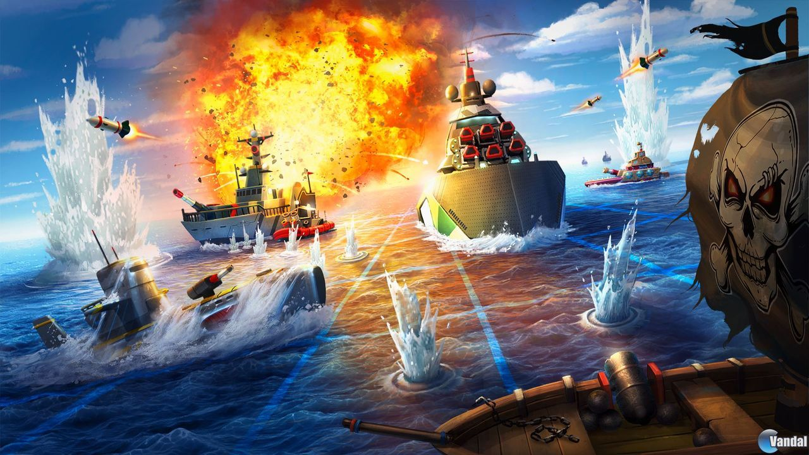

# Battleship Python (Hundir la Flota)

Juego de **Hundir la Flota** para la terminal, desarrollado en Python. Juegas contra la máquina en un tablero de 10x10: colocas tus barcos, disparas por coordenadas e intentas hundir toda la flota enemiga antes de que ella hunda la tuya.

## Características

- Tablero de **10x10** con visualización en la terminal mediante emojis.
- Colocación **manual** de tus barcos (fila, columna y orientación).
- La máquina coloca sus barcos de forma **aleatoria**.
- Menú principal con opción de jugar o salir.
- Posibilidad de **cancelar la partida** escribiendo `salir` al introducir una coordenada.
- Validación de coordenadas (no se aceptan valores fuera del tablero).
- La máquina nunca dispara dos veces a la misma casilla.
- Mensajes de **tocado, agua y hundido**, y recuento de barcos restantes del rival.
- Marcador de puntos (impactos) para cada jugador.
- Radar que muestra solo tus disparos sobre el tablero enemigo.

## Estructura del proyecto

```
Battleship_Python/
├── main.py      # Bucle principal del juego (turnos, menú, victoria)
├── utils.py     # Funciones auxiliares (tableros, barcos, disparos, validaciones)
└── README.md    # Este archivo
```

## Requisitos

- **Python 3.8** o superior
- **NumPy**

## Instalación y ejecución

1. Clona el repositorio:
   ```bash
   git clone <URL-de-tu-repositorio>
   cd Battleship_Python
   ```

2. (Opcional) Crea un entorno virtual:
   ```bash
   python -m venv venv
   venv\Scripts\activate        # Windows
   source venv/bin/activate     # Linux / macOS
   ```

3. Instala las dependencias:
   ```bash
   pip install numpy
   ```

4. Ejecuta el juego:
   ```bash
   python main.py
   ```

> 💡 Se recomienda usar una terminal con soporte para emojis y colores ANSI (Windows Terminal, terminal de VS Code, etc.).

## Cómo se juega

### 1. Menú principal
Al iniciar aparece el menú:

- `1` → Comenzar batalla
- `2` → Salir del juego

### 2. Colocación de barcos
Introduce tu nombre y coloca tus 6 barcos indicando:

- **Fila inicial** (1 a 10)
- **Columna inicial** (1 a 10)
- **Orientación**: `N` (norte), `S` (sur), `E` (este) u `O` (oeste)

El barco se extiende desde la casilla inicial en la dirección elegida. Si se sale del tablero o choca con otro barco, tendrás que volver a colocarlo.

| Barco          | Tamaño | Cantidad |
|----------------|:------:|:--------:|
| Destructor     |   2    |    3     |
| Acorazado      |   3    |    2     |
| Portaaviones   |   4    |    1     |

### 3. Turnos
Cada ronda tiene dos turnos:

1. **Tu turno**: introduces la coordenada `x` (fila) y la coordenada `y` (columna) a la que quieres disparar. Después se muestra tu radar actualizado.
2. **Turno del Jugador 2 (máquina)**: dispara a una casilla aleatoria que no haya probado antes.

Si introduces una casilla que ya habías disparado, el juego te pedirá otra.

### 4. Final de la partida
Gana quien hunda antes todos los barcos del rival. Al terminar, vuelves al menú principal.

Para cancelar una partida en curso, escribe `salir` al pedir una coordenada.

## Leyenda del tablero

| Símbolo interno | Emoji | Significado               |
|:---------------:|:-----:|---------------------------|
| `~`             |  🌊   | Agua sin descubrir        |
| `O`             |  🚢   | Barco                     |
| `X`             |  🔥   | Barco tocado              |
| `-`             |  💦   | Disparo fallado (agua)    |

## Funciones principales (`utils.py`)

| Función | Descripción |
|---------|-------------|
| `menu()` | Muestra el menú principal y devuelve la opción elegida |
| `imprimir_tablero_color(tablero)` | Imprime el tablero con emojis |
| `crea_barco_aleatorio(...)` | Coloca un barco de forma aleatoria (máquina) |
| `crea_barco_aleatorio_j1(...)` | Pide al jugador la posición y orientación de cada barco |
| `coloca_barco_plus(tablero, barco)` | Comprueba que el barco cabe y no choca; devuelve el tablero actualizado o `False`. |
| `recibir_disparo(...)` | Procesa un disparo: agua, tocado o hundido. |
| `comprueba_coordenada_x/y(...)` | Valida que las coordenadas estén dentro del tablero. |
| `dic_barcos(...)` | Lleva la cuenta de los barcos de cada tipo. |

## Tecnologías

- Python
- NumPy
- Módulos estándar: `random`, `time`, `os`

## Posibles mejoras

- Que la IA dispare de forma más inteligente (cerca de un impacto).
- Gestionar entradas no numéricas en el menú y en las coordenadas sin que el programa se detenga, así como pulsar en otras teclas como Enter
- Permitir elegir el tamaño del tablero.
- Modo de dos jugadores humanos.